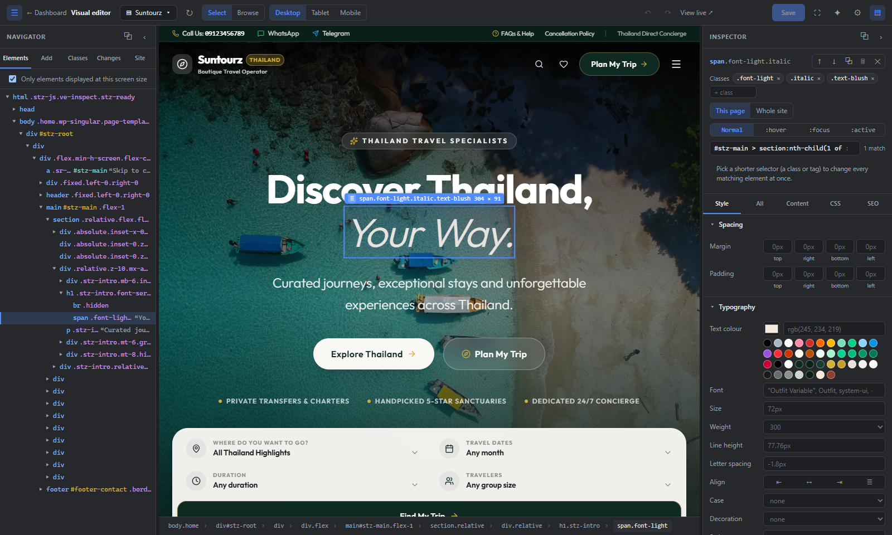

# Visual Editor

> A visual site builder and click-to-edit editor for **any** WordPress theme — build pages and templates, style every element per device, reusable components, React islands, motion, SEO — and let an AI assistant work on the site with you over MCP. No theme files touched.

The editor loads your **real, live site** in a same-origin iframe and works like browser dev tools with a *Save* button: hover to see the box, click to select, then edit. It is not a box-based page builder — it edits the page you already have, tag by tag (even the `<head>`), and stores the result as a small, portable document.

It is one of three independent projects, and it needs **none** of the others:

| Project | Role |
| --- | --- |
| [react-theme](https://github.com/rnd21312/react-theme) | Public website design |
| [booking-core](https://github.com/rnd21312/booking-core) | Tours, bookings, REST API, admin screens |
| **visual-editor** (this repo) | Visual editor for any theme |

## Features

**Edit any element of any page**
- Click to select; style per **device** (desktop / tablet / mobile) and **state** (hover, focus, active, `::before`, `::after`); edit text inline; move (drag), duplicate, hide per device, delete, change tag, custom CSS.
- **Scopes**: one page, a whole template (every product / post / category page) or the whole site.
- Dockable panels, layers tree, right-click menu, multi-select, undo / redo, **Ctrl+S** to publish. Nothing is live until you save.

**Build**
- **Builder pages** (theme / full page / blank canvas) and **builder templates** (single product, single post, archives, search, 404, header, footer) with live data — `{{ post.title }}`, `{{ product.price_html }}`, loops, menus, shortcodes, Gutenberg blocks.
- **Components** with props and slots, **React islands** (any npm package via esm.sh), shadcn-style UI kit, **GSAP motion** presets, **Tailwind CSS** compiled in the editor, libraries (Swiper, Alpine, Lenis, Lottie…), design tokens and Google fonts.
- Pages, posts, WooCommerce products, menus, media, forms, revisions, export / import. Persian (RTL) interface when the user language is Persian.

**SEO**
- Per page / template title, description, share image, canonical, robots and JSON-LD; page audit. Works with Yoast, Rank Math, AIOSEO, SEOPress or on its own.

**AI (MCP)**
- A full MCP server (~60 tools): the AI sees pages, edits styles and layouts, builds pages and templates, manages content, and can ask the open editor for screenshots.
- Several **API keys** with levels `read` · `draft` (you approve) · `live` · `admin`; **OAuth 2.1** so web apps such as Claude.ai connect without a pasted key; a dashboard page with connection test, setup snippets, site description and activity log. See [docs/ai-mcp.md](docs/ai-mcp.md).

**Safe by design**
- Revisions with one-click restore, three-way merge of concurrent saves, DB-locked writes, escape-aware CSS validation, hashed keys and tokens, per-key rate limits. Deactivate the plugin and your theme is untouched.

## Requirements

- WordPress **6.5+**, PHP **8.1+**
- Any theme (classic, block or page builder)

## Install

1. Download `visual-editor.zip` from the [latest release](https://github.com/rnd21312/visual-editor/releases/latest).
2. **Plugins → Add New → Upload Plugin** → choose the zip → **Install Now** → **Activate**.
3. Open **Visual editor** in the dashboard menu, or click **Edit visually** in the admin bar while viewing your site.

Direct URL: `https://your-site.com/?sve_editor=1`

Full guide: [docs/installation.md](docs/installation.md).

## Documentation

| Guide | Contents |
| --- | --- |
| [Installation](docs/installation.md) | Install, access control, uninstall |
| [AI & MCP](docs/ai-mcp.md) | Keys, OAuth, permission levels, tools, limits |
| [Architecture](docs/architecture.md) | PHP and React structure, save pipeline, security |
| [Development](docs/development.md) | Local setup, tests, release |

## License

GPL-2.0-or-later — see [LICENSE](LICENSE).
